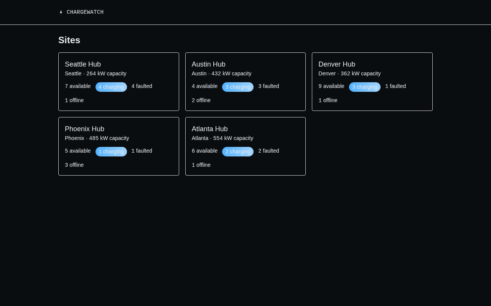

# ChargeWatch

[](https://github.com/Khatrigarv24/chargewatch/actions/workflows/ci.yml)

A small full-stack monitoring dashboard for an EV charging network: sites,
chargers, live status, and energy usage over time.



**Stack:** React + TypeScript (Vite, Tailwind, Recharts) · Node.js + Express
+ TypeScript · PostgreSQL · Vitest · Playwright · Docker Compose · GitHub
Actions.

## Architecture

```
client (Vite/React, :5173) --HTTP--> server (Express, :3000) --SQL--> db (Postgres, :5432)
```

- `server/sql/schema.sql` — `sites`, `chargers`, `sessions`, `energy_readings`.
- `server/src/db/seed.ts` — generates 5 sites, ~60 chargers, 30 days of
  sessions, and 500k+ energy readings via batched `UNNEST` inserts.
- `server/src/routes/` — REST API (see below).
- `client/src/pages/` — sites overview and site detail (chargers table,
  status filter, energy chart, start/stop session).

## API

| Method | Path | Description |
| --- | --- | --- |
| GET | `/api/sites` | All sites, with charger counts by status |
| GET | `/api/sites/:id` | One site's chargers and today's energy use |
| GET | `/api/sites/:id/energy?from=&to=` | Hourly energy totals (the heavy aggregate query) |
| GET | `/api/chargers?status=` | Chargers filtered by status |
| POST | `/api/chargers/:id/sessions/start` | Start a charging session |
| POST | `/api/chargers/:id/sessions/stop` | Stop the open session |

## Running it

```bash
cp .env.example .env   # defaults already match docker-compose
docker compose up -d db
npm install
npm run --workspace server seed
npm run dev:server      # http://localhost:3000
npm run dev:client       # http://localhost:5173
```

Or the whole stack in containers: `docker compose up` (add `--build` after
pulling new code — the client/server images aren't volume-mounted, so they
otherwise keep serving whatever was baked in at the last build).

## Tests

```bash
npm run test:unit   # vitest: schema/helper unit tests + supertest integration tests, against a real Postgres (DATABASE_URL)
npm run test:e2e    # playwright: sites overview, filtering, start/stop session, energy chart, against the running app
```

CI (`.github/workflows/ci.yml`) runs both against a Postgres service container
on every push.

Running the e2e suite resets the database to a small deterministic fixture
(by design, for reproducible tests). If your local data shrinks to one site
afterwards, that's why — re-run `npm run --workspace server seed` to restore
the full 5-site demo dataset.

## Query optimization

`GET /api/sites/:id/energy` (the hourly energy aggregate) went from
**29.7ms to 6.3ms** (~4.7x) after adding
`energy_readings(charger_id, recorded_at)` and rewriting the query to filter
by charger id instead of joining on it — buffer reads dropped from 4,785 to
110. See [`docs/query-optimization.md`](docs/query-optimization.md) for the
full before/after `EXPLAIN ANALYZE` output and why a wide date range doesn't
show the same win.

## Extending toward real telemetry

Right now `energy_readings` and `sessions` are seeded/simulated. Each charger
would map to a real OCPP 1.6/2.0.1 charge point: `StatusNotification` for
charger status, `MeterValues` for `energy_readings`, and
`StartTransaction`/`StopTransaction` for `sessions` — the schema here is
already shaped to receive that without changes.
